<div align="center">

# 🪐 Orbit

**Your personal assistant, on your own server.**

Tasks, calendar, money, notes, habits, documents, and fitness in one calm app,
with an optional AI assistant that only sees what you allow.

[](https://github.com/nithiin7/orbit-assistant/actions/workflows/ci.yml)
[](LICENSE)
[](docs/deployment.md)
[](CONTRIBUTING.md)

[Quick start](#quick-start) · [Features](#features) · [Self-hosting](docs/deployment.md) ·
[Contributing](CONTRIBUTING.md)

<picture>
  <source media="(prefers-color-scheme: dark)" srcset="docs/screenshots/hero-dark.webp">
  <source media="(prefers-color-scheme: light)" srcset="docs/screenshots/hero-light.webp">
  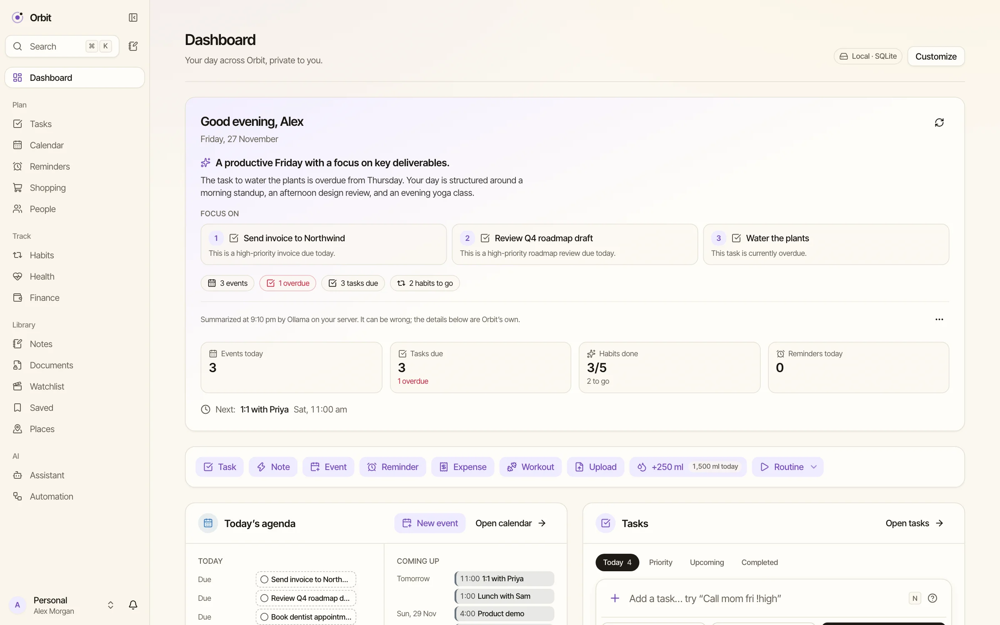
</picture>

</div>

## Why Orbit

- **Private by design.** Your data stays on the server you run. Nothing leaves it unless you
  connect an AI provider or a Google or Microsoft account.
- **Everything in one place.** One search, one command palette, and one dashboard for your
  whole day.
- **AI on your terms.** Off by default. Use local models with Ollama, or bring your own OpenAI,
  Anthropic, or Gemini key. Answers cite their sources, and actions wait for your approval.
- **Easy to run.** One `docker compose up`, on SQLite or PostgreSQL.

## Features

| Module                  | What you get                                                                                                                    |
| ----------------------- | ------------------------------------------------------------------------------------------------------------------------------- |
| 🏠 **Dashboard**        | Today at a glance: a daily briefing (with an optional AI summary), agenda, due tasks, habits, payments, and widgets you arrange |
| ✅ **Tasks**            | Lists, repeating tasks, a quick add that reads dates, repeats, and priority, a focus timer, and drag to reorder                 |
| 🛒 **Shopping**         | Shopping lists you reorder by dragging, with gift ideas for the people in your life                                             |
| 🔔 **Reminders**        | One-off and repeating reminders, in-app notifications, and optional push notifications                                          |
| 📅 **Calendar**         | Month, week, day, and agenda views, recurring events, and drag tasks onto a day to schedule them                                |
| 💰 **Finance**          | Accounts, budgets, loans, subscriptions, investments with SIPs, goals, net worth, and bank statement import you review first    |
| 📝 **Notes**            | Rich-text editor, folders, tags, backlinks, a daily journal, and Markdown                                                       |
| 🔁 **Habits**           | Streaks, routines, a Today view, history heatmaps, and templates to start from                                                  |
| 📂 **Documents**        | A personal vault with previews, versions, and expiry reminders                                                                  |
| 💪 **Health**           | Workouts, personal records, activity rings, body measurements, food and water, and goals                                        |
| 🎬 **Watchlist**        | Movies and series to watch, episode tracking, ratings, and a "watch tonight" picker                                             |
| 🔖 **Saved**            | Links you come back to, plus reels, videos, and articles to get to later, in collections                                        |
| 🗺️ **Places**           | Where you've been and want to go, on a world map that tallies countries and continents                                          |
| 👥 **People**           | Birthdays and anniversaries with reminders, and who owes whom, split from your expenses                                         |
| 🏆 **Profile**          | Achievements and XP for using Orbit, and a store to spend XP on frames and banners                                              |
| 🔍 **Search**           | One search across every module, from anywhere with <kbd>Cmd/Ctrl</kbd>+<kbd>K</kbd>                                             |
| ✨ **AI assistant**     | Chat with your data, with cited sources, and talk to it by voice; no audio is stored                                            |
| 🤖 **Automation**       | Workflows on a schedule or trigger, and an agent that asks before it changes anything                                           |
| 🔗 **Integrations**     | Google and Microsoft calendars, mail, and files                                                                                 |
| 🛡️ **Backup & restore** | Encrypted, scheduled backups and exports to JSON, CSV, iCalendar, and Markdown                                                  |
| 🎨 **Make it yours**    | Light and dark themes, color palettes, fonts, compact density, undo for deletes, and an installable app                         |

## Screenshots

Shown with sample data. The assistant runs on a local model through Ollama.

<table>
  <tr>
    <td align="center">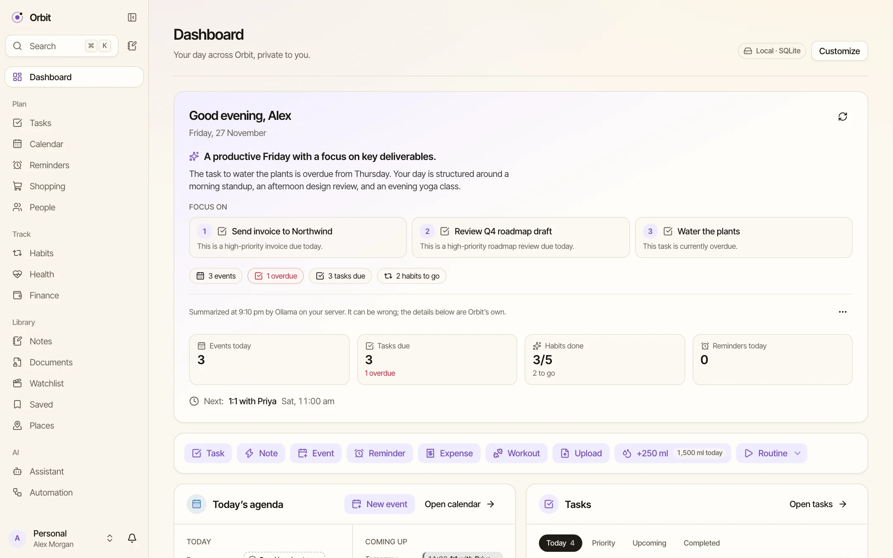<br><sub>Dashboard, light</sub></td>
    <td align="center">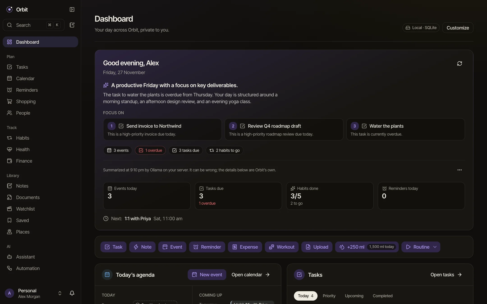<br><sub>Dashboard, dark</sub></td>
  </tr>
  <tr>
    <td align="center">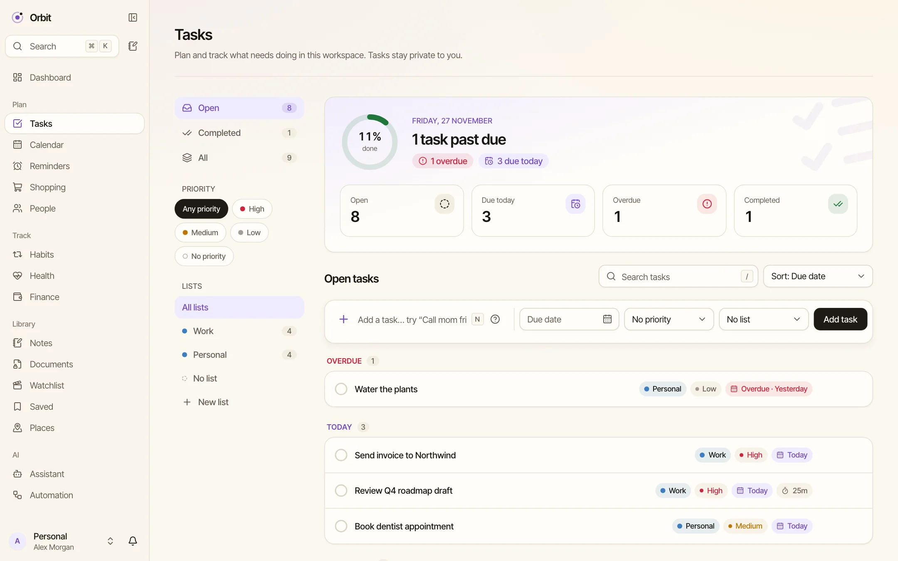<br><sub>Tasks</sub></td>
    <td align="center">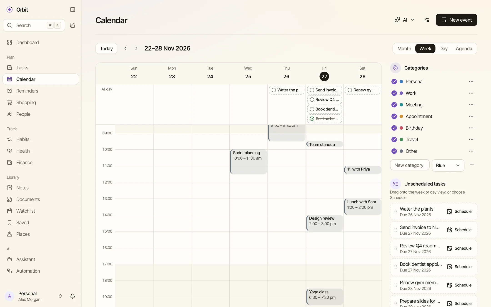<br><sub>Calendar</sub></td>
  </tr>
  <tr>
    <td align="center">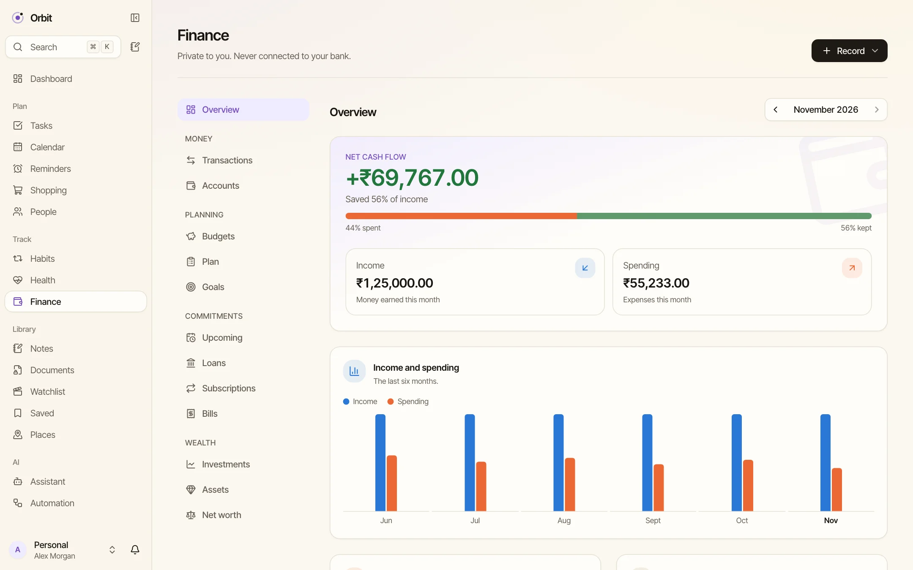<br><sub>Finance</sub></td>
    <td align="center">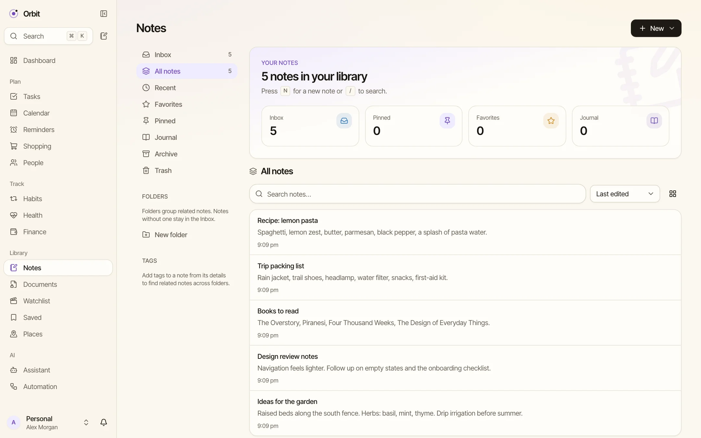<br><sub>Notes</sub></td>
  </tr>
  <tr>
    <td align="center">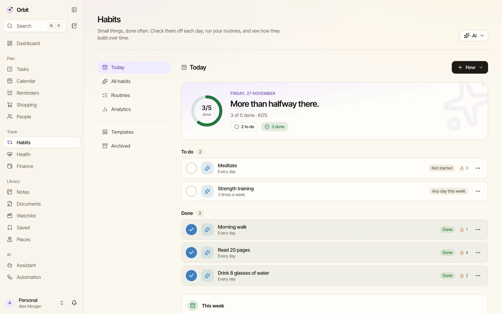<br><sub>Habits</sub></td>
    <td align="center">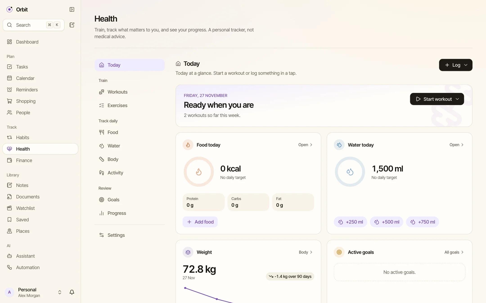<br><sub>Health</sub></td>
  </tr>
  <tr>
    <td align="center">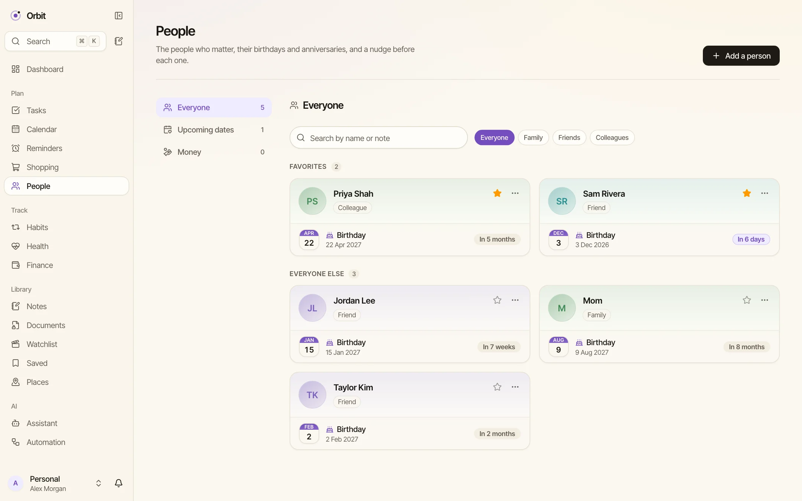<br><sub>People</sub></td>
    <td align="center">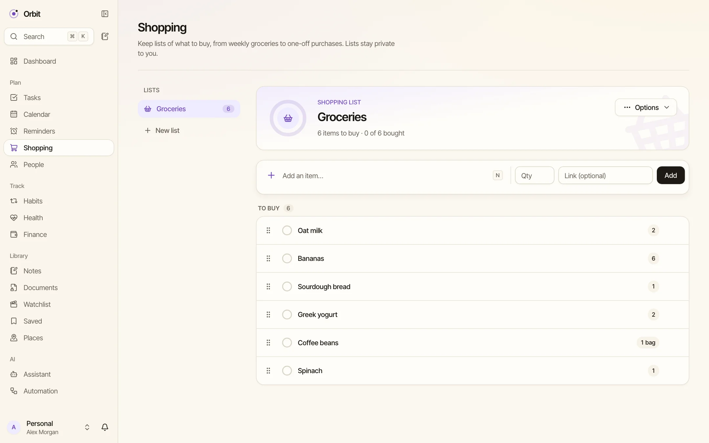<br><sub>Shopping</sub></td>
  </tr>
  <tr>
    <td align="center">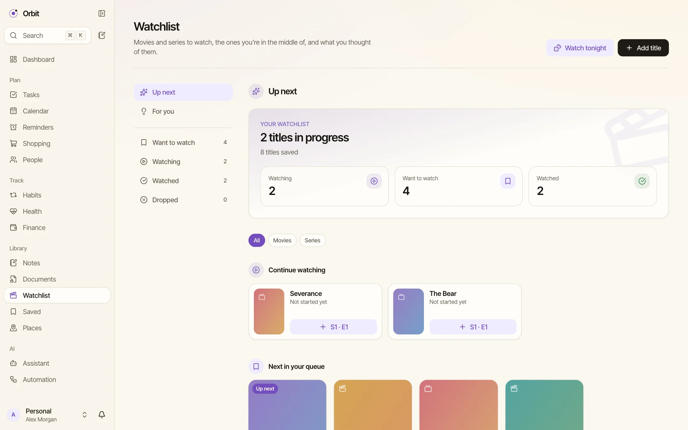<br><sub>Watchlist</sub></td>
    <td align="center">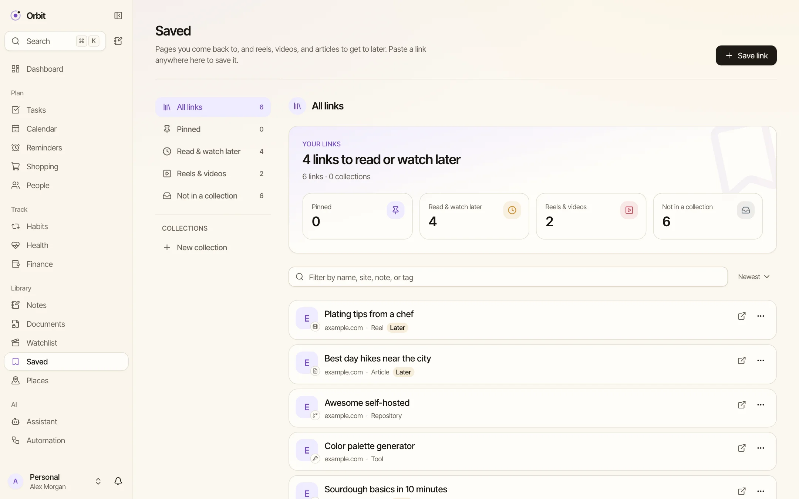<br><sub>Saved</sub></td>
  </tr>
  <tr>
    <td align="center">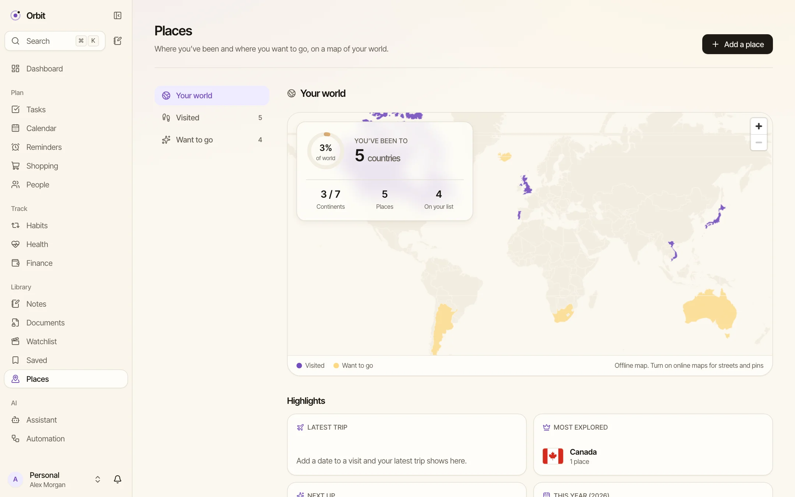<br><sub>Places</sub></td>
    <td align="center">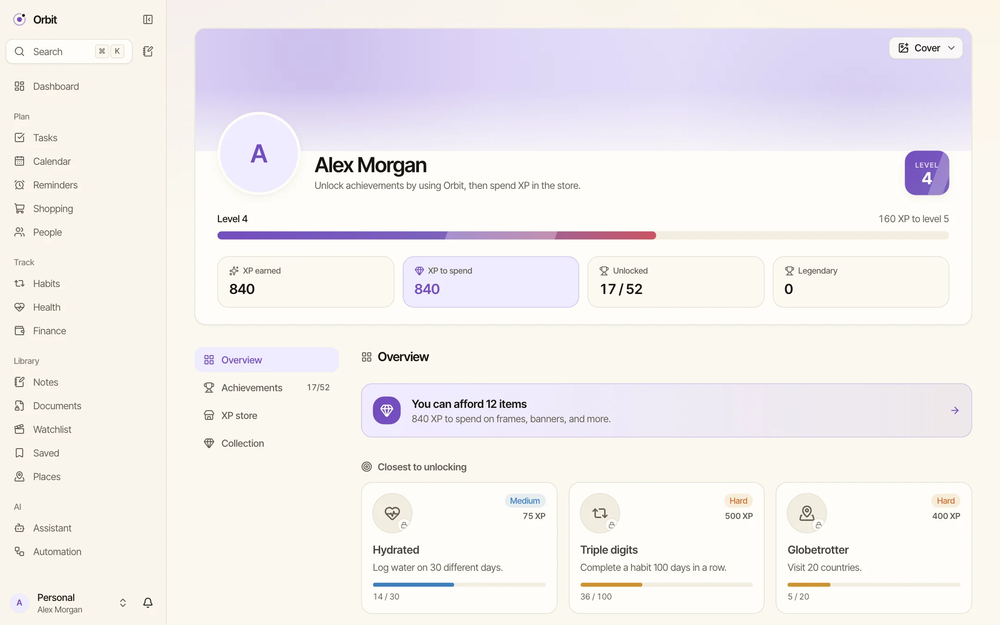<br><sub>Profile</sub></td>
  </tr>
  <tr>
    <td align="center">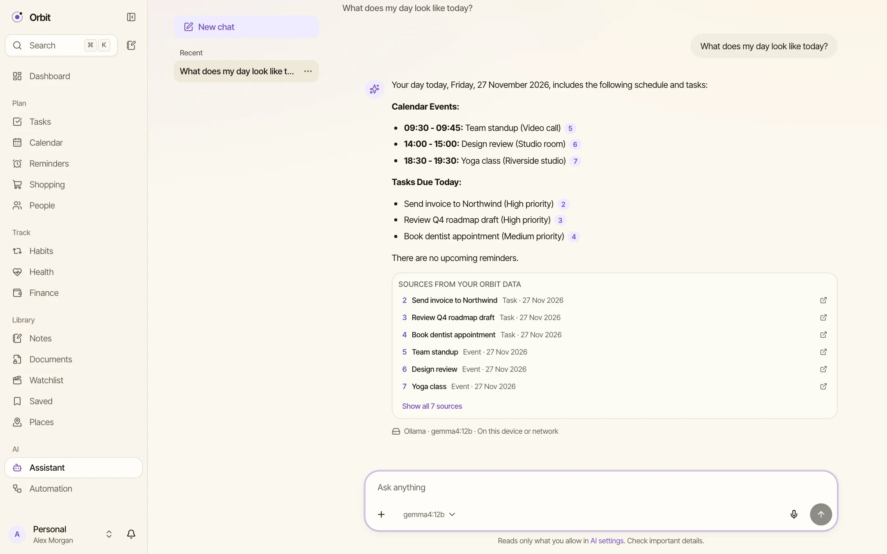<br><sub>AI assistant</sub></td>
    <td align="center">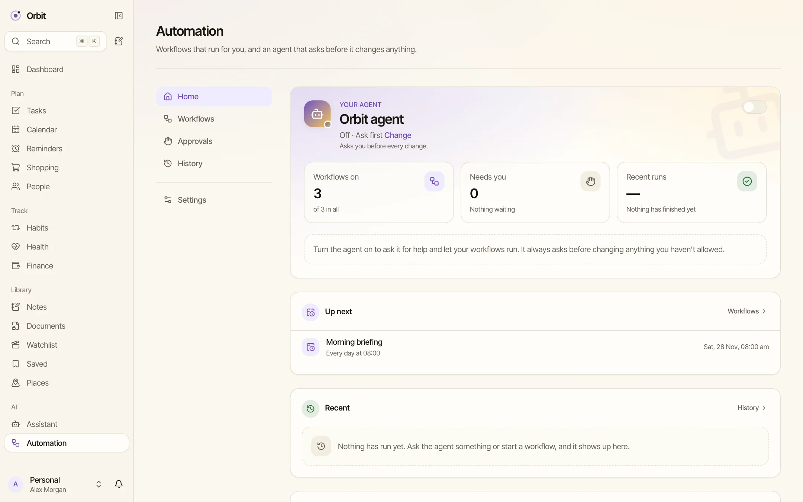<br><sub>Automation</sub></td>
  </tr>
</table>

## Quick start

### With Docker

```bash
git clone https://github.com/nithiin7/orbit-assistant.git
cd orbit-assistant
docker compose up -d --build
```

Open <http://localhost:3000> and create your account. For HTTPS on your own domain, backups, and
upgrades, see the [deployment guide](docs/deployment.md).

### From source

Requires Node.js 24, pnpm 11, Python 3.12, and [uv](https://docs.astral.sh/uv/).

```bash
pnpm install
uv sync --all-packages
pnpm db:migrate
pnpm dev        # web on :3000, API on :8000
```

## Built with

Next.js 16 · React 19 · TypeScript · Tailwind CSS v4 · FastAPI · Python 3.12 · SQLAlchemy ·
SQLite or PostgreSQL

## Documentation

- [Deployment](docs/deployment.md): self-hosting, HTTPS, and upgrades
- [Integrations](docs/integrations.md): connecting Google and Microsoft
- [Development](docs/development.md): local setup, configuration, and tests
- [Architecture](docs/architecture.md): how Orbit is built

## Contributing

Contributions are welcome. Read the [contributing guide](CONTRIBUTING.md) and the
[code of conduct](CODE_OF_CONDUCT.md). Please report security issues privately as described in
the [security policy](SECURITY.md).

## License

[Apache License 2.0](LICENSE)
