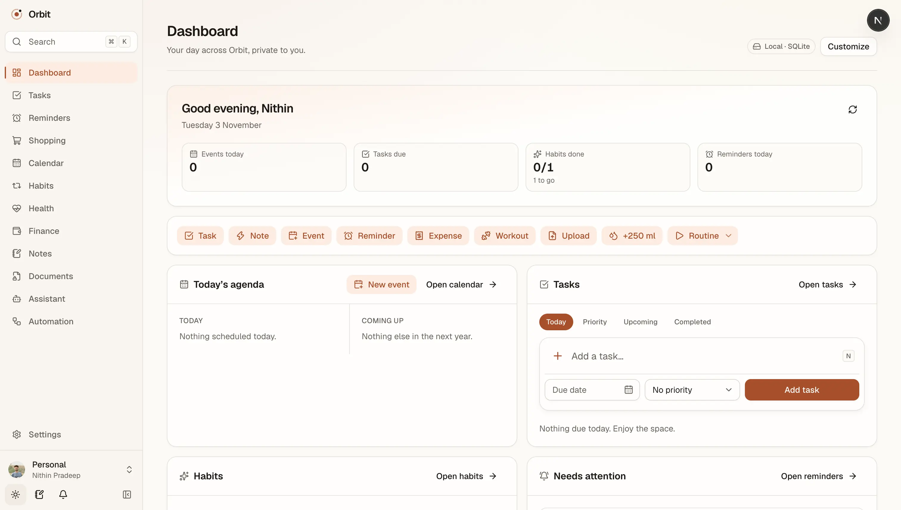
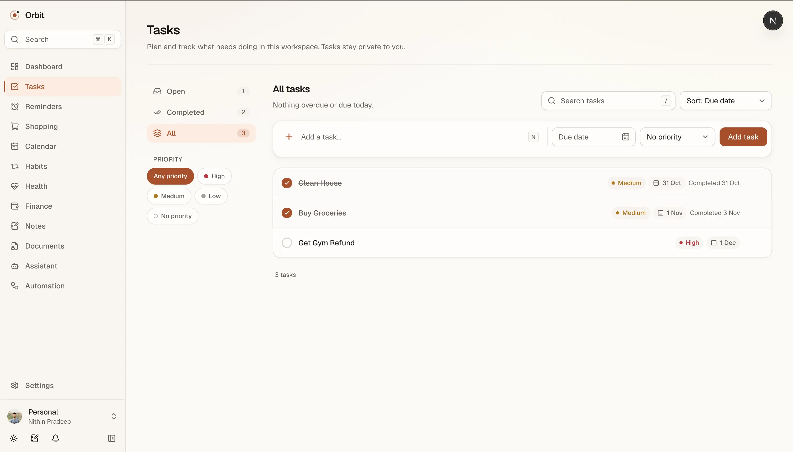
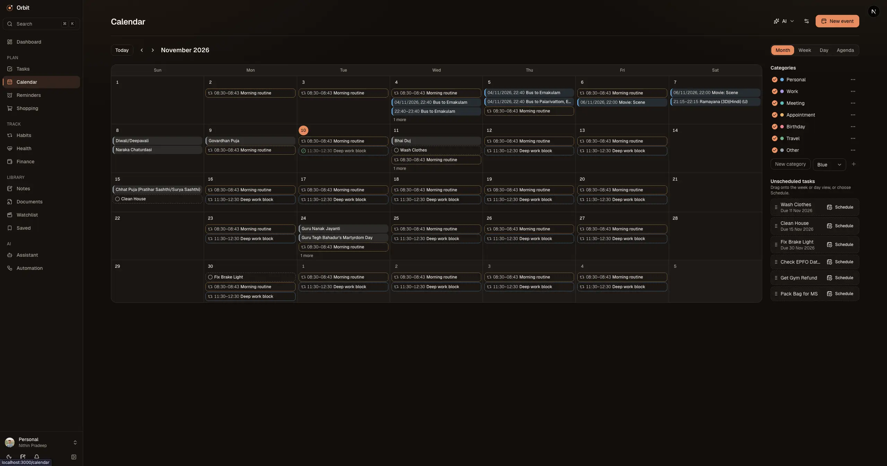
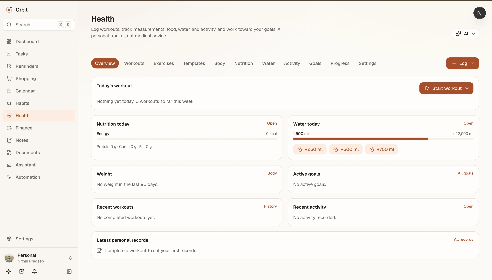
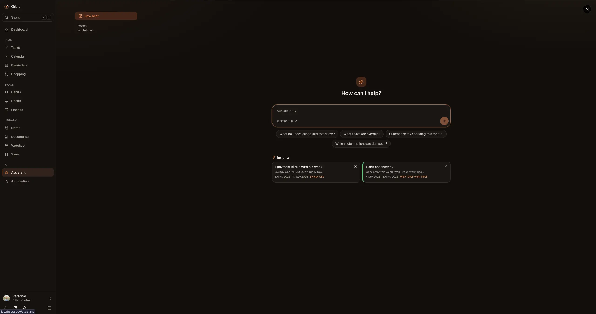

<div align="center">

# 🪐 Orbit

**Your personal assistant, on your own server.**

Tasks, calendar, money, notes, habits, documents, and fitness in one calm app,
with an optional AI assistant that only sees what you allow.

[](https://github.com/nithiin7/orbit-assistant/actions/workflows/ci.yml)
[](LICENSE)
[](docs/deployment.md)
[](CONTRIBUTING.md)

[Quick start](#quick-start) · [Features](#features) · [Self-hosting](docs/deployment.md) ·
[Contributing](CONTRIBUTING.md)



</div>

## Why Orbit

- **Private by design.** Your data stays on the server you run. Nothing leaves it unless you
  connect an AI provider or a Google or Microsoft account.
- **Everything in one place.** One search, one command palette, and one dashboard for your
  whole day.
- **AI on your terms.** Off by default. Use local models with Ollama, or bring your own OpenAI,
  Anthropic, or Gemini key. Answers cite their sources, and actions wait for your approval.
- **Easy to run.** One `docker compose up`, on SQLite or PostgreSQL.

## Features

| Module                  | What you get                                                                        |
| ----------------------- | ----------------------------------------------------------------------------------- |
| 🏠 **Dashboard**        | Today at a glance: agenda, due tasks, habits, payments, and customizable widgets    |
| ✅ **Tasks**            | Tasks, shopping lists, and reminders, including recurring ones                      |
| 📅 **Calendar**         | Month, week, day, and agenda views, recurring events, and drag-and-drop scheduling  |
| 💰 **Finance**          | Accounts, budgets, loans, subscriptions, investments, goals, and net worth          |
| 📝 **Notes**            | Rich-text editor, folders, tags, backlinks, a daily journal, and Markdown           |
| 🔁 **Habits**           | Streaks, routines, a Today view, and history heatmaps                               |
| 📂 **Documents**        | A personal vault with previews, versions, and expiry reminders                      |
| 💪 **Health**           | Workout logging, personal records, body measurements, nutrition, and goals          |
| 🎬 **Watchlist**        | Movies and series to watch, episode tracking, ratings, and a "watch tonight" picker |
| 🔍 **Search**           | One search across every module, from anywhere with <kbd>Cmd/Ctrl</kbd>+<kbd>K</kbd> |
| ✨ **AI assistant**     | Chat with your data, summaries and drafts, and automations you approve              |
| 🔗 **Integrations**     | Google and Microsoft calendars, mail, and files                                     |
| 🛡️ **Backup & restore** | Encrypted, scheduled backups and exports to JSON, CSV, iCalendar, and Markdown      |

## Screenshots

<table>
  <tr>
    <td></td>
    <td></td>
  </tr>
  <tr>
    <td></td>
    <td></td>
  </tr>
</table>

## Quick start

### With Docker

```bash
git clone https://github.com/nithiin7/orbit-assistant.git
cd orbit-assistant
docker compose up -d --build
```

Open <http://localhost:3000> and create your account. For HTTPS on your own domain, backups, and
upgrades, see the [deployment guide](docs/deployment.md).

### From source

Requires Node.js 24, pnpm 11, Python 3.12, and [uv](https://docs.astral.sh/uv/).

```bash
pnpm install
uv sync --all-packages
pnpm db:migrate
pnpm dev        # web on :3000, API on :8000
```

## Built with

Next.js 16 · React 19 · TypeScript · Tailwind CSS v4 · FastAPI · Python 3.12 · SQLAlchemy ·
SQLite or PostgreSQL

## Documentation

- [Deployment](docs/deployment.md): self-hosting, HTTPS, and upgrades
- [Integrations](docs/integrations.md): connecting Google and Microsoft
- [Development](docs/development.md): local setup, configuration, and tests
- [Architecture](docs/architecture.md): how Orbit is built

## Contributing

Contributions are welcome. Read the [contributing guide](CONTRIBUTING.md) and the
[code of conduct](CODE_OF_CONDUCT.md). Please report security issues privately as described in
the [security policy](SECURITY.md).

## License

[Apache License 2.0](LICENSE)
